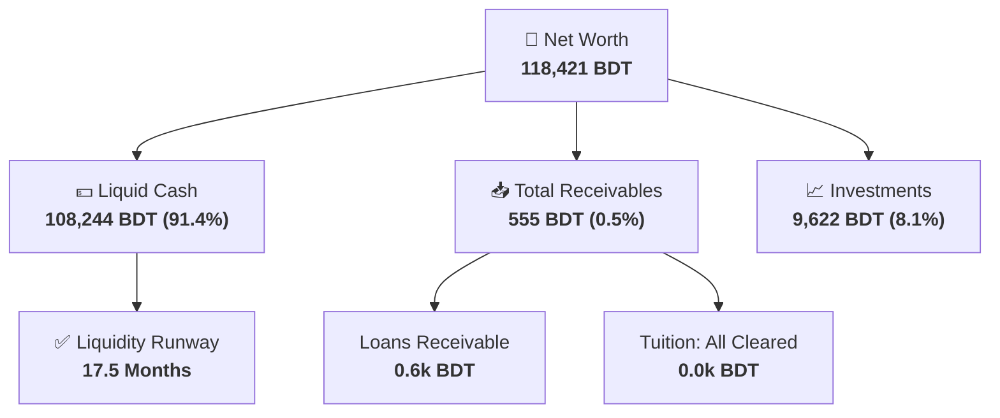
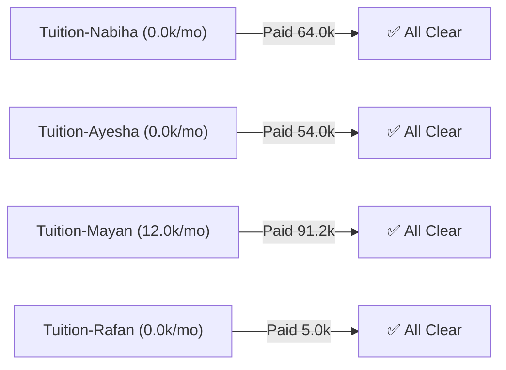
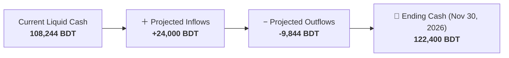

# 📊 Financial Intelligence Report

> 📅 **Generated**: `2026-10-17 21:41:02` | **Reporting Period**: Monthly Cycle | **Database**: Supabase
>
> 🚨 **Immediate Action Items**
>
> 1. **Control Budget Drift**: Food & Drink (++109%), Bills & Fees (++467%) are spiking. Apply category caps.

---

## Executive Summary

Total net worth is **118,421 BDT**, with **108,244 BDT** in liquid cash providing **17.5 months** of operating runway. This month shows a **🔴 108,507 BDT deficit**. Forward projection to **Nov 30, 2026** estimates ending balance of **122,400 BDT**.

## 1 · Asset Allocation & Liquid Wallets

> 💡 **Asset Overview**: Breakdown of your net worth components alongside current balances of your liquid checking and savings accounts.

### Asset Allocation

| Asset Class | Allocation |
| :--- | ---: |
| Liquid Cash & Bank | 91.4% |
| Loan Receivables | 0.5% |
| Tuition Receivables | 0.0% |
| Investments | 8.1% |
| **Total** | **100%** |

### Wallets & Accounts

| Wallet / Account | Type | Balance (BDT) |
| :--- | :--- | ---: |
| Bank | Personal | 86,056 |
| Biniyog Investment | Investment | 9,622 |
| BKash | Personal | 9,408 |
| Savings | Personal | 8,000 |
| redotPay | Personal | 3,671 |
| Cash | Personal | 990 |
| Mom Loan | Lending | 555 |
| Binance | Personal | 119 |
| Dadi Loan | Lending | 0 |
| Mayan Loan | Lending | 0 |
| Ayman Loan | Lending | 0 |
| Zayed Loan | Lending | 0 |
| Waraka Loan | Lending | 0 |
| iFarmer Investment | Investment | 0 |
| WeGro Investment | Investment | 0 |
| Dad Loan | Lending | 0 |

---

## 2 · Receivables & Loan Recovery

### Tuition Collection Pipeline

| Student | Current Rate | Expected YTD | Received YTD | Collection |
| :--- | ---: | ---: | ---: | :---: |
| Tuition-Nabiha | 0 | 64,000 | 64,000 | 100% |
| Tuition-Ayesha | 0 | 54,000 | 54,000 | 100% |
| Tuition-Mayan | 12,000 | 91,200 | 91,200 | 100% |
| Tuition-Rafan | 0 | 5,000 | 5,000 | 100% |

### Loan Recovery Status

| Borrower | Outstanding (BDT) | Status | Last Lent |
| :--- | ---: | :--- | :--- |
| Mom | 555 | 0-30 days | 2026-10-17 |

---

## 3 · Monthly Income & Spending Summary

> 💡 **Cash Flow Details**: Top expense categories for the current period and overall macro-financial summary.

### Financial Summary

| Financial Metric | Amount (BDT) |
| :--- | ---: |
| Gross Income | 41,282 |
| Gross Expenses | 149,789 |
| Net Cash Flow | -108,507 |
| Gross Savings Rate | -262.8% |
| Routine Savings Rate | 77.2% |

### Top Expense Categories

| Category | Spent (BDT) | Share |
| :--- | ---: | ---: |
| General Shop | 140,395 | 93.7% |
| Food & Drink | 4,967 | 3.3% |
| City Commute | 2,289 | 1.5% |
| Bills & Fees | 1,450 | 1.0% |
| Daily Living | 331 | 0.2% |
| Subscription | 326 | 0.2% |

---

## 4 · Cash Flow Forecast (to Nov 30, 2026)

### Expected Inflow Breakdown

| Inflow Source | Expected Amount (BDT) | Details |
| :--- | ---: | :--- |
| Tuition-Nabiha | 0 | No session in window |
| Tuition-Ayesha | 0 | No session in window |
| Tuition-Mayan | 24,000 | Months: Oct:12,000, Nov:12,000 |
| Tuition-Rafan | 0 | No session in window |

---

## 5 · Budget Drift, Anomalies & Commute Efficiency

> 💡 **Anomaly Detection**: Compares recent 30-day spend against the 90-day historical baseline to flag unusual activity.

> 🚨 **Critical Expense Spikes**: Food & Drink (+109%), Bills & Fees (+467%) are trending significantly above their 90-day baseline.

> 💡 **Major Cost Reductions**: General Shop (-70%), Gifts & Alms (-64%), Subscription (-25%) are trending below baseline, increasing your routine savings rate.

### Escalating Expense Tags

| Tag | Drift (BDT) | % Change |
| :--- | ---: | ---: |
| FoodSnacks | +4,497 | +1046% |
| BankCharge | +1,080 | +489% |
| CampusTrip | +429 | +26% |
| GroomSpend | +198 | +149% |
| MobileBill | +143 | +2150% |

### Commute Breakdown

| Commute Type | Spent (BDT) | Trips |
| :--- | ---: | ---: |
| CampusTrip | 2,099 | 18 |
| SocialTrip | 180 | 1 |
| DailyCommute | 10 | 1 |

### Tutor Travel ROI
**Gross Tuition Earned**: `28,000 BDT` | **Travel Cost**: `-0 BDT` | **Net Yield**: `100.0%` (`28,000 BDT`)

---

*Report compiled automatically by Antigravity Financial Intelligence Suite · 2026-10-17 21:41:02*