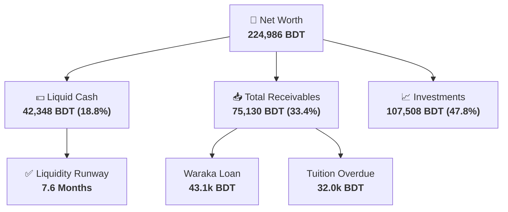
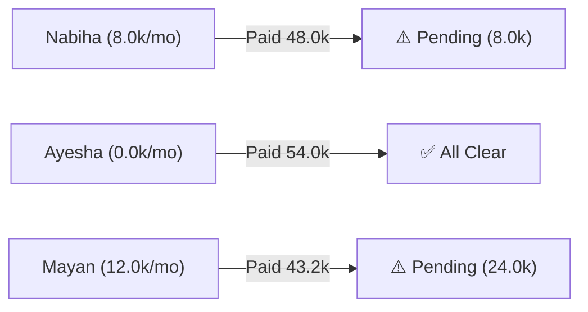
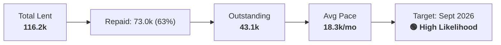
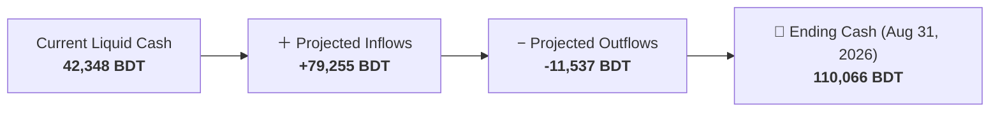

# 📊 Financial Intelligence Report

> 📅 **Generated**: `2026-07-30 11:29:00` | **Reporting Period**: Monthly Cycle | **Database**: Supabase
>
> 🚨 **Immediate Action Items**
>
> 1. **Collect Tuition: Nabiha**: `8,000 BDT` overdue (Collection: `86%`).
> 2. **Collect Tuition: Mayan**: `24,000 BDT` overdue (Collection: `64%`).
> 3. **Control Budget Drift**: City Commute (++117%), Food & Drink (++52%) are spiking. Apply category caps.
> 4. **Loan Recovery (Waraka)**: `43,130 BDT` remaining (Due: Sept 2026).

---

## Executive Summary

Total net worth is **224,986 BDT**, with **42,348 BDT** in liquid cash providing **7.6 months** of operating runway. This month shows a **🔴 63,803 BDT deficit**. Forward projection to **Aug 31, 2026** estimates ending balance of **110,066 BDT**.

## 1 · Asset Allocation & Liquid Wallets

> 💡 **Asset Overview**: Breakdown of your net worth components alongside current balances of your liquid checking and savings accounts.

### Asset Allocation

| Asset Class | Allocation |
| :--- | ---: |
| Liquid Cash & Bank | 18.8% |
| Loan Receivables | 19.2% |
| Tuition Receivables | 14.2% |
| Investments | 47.8% |
| **Total** | **100%** |

### Liquid Wallets

| Wallet / Account | Balance (BDT) |
| :--- | ---: |
| Bank | 25,651 |
| Savings | 16,000 |
| BKash | 367 |
| Cash | 265 |
| Binance | 65 |

---

## 2 · Receivables & Loan Recovery

### Tuition Collection Pipeline

| Student | Current Rate | Expected YTD | Received YTD | Collection |
| :--- | ---: | ---: | ---: | :---: |
| Tuition: Nabiha | 8,000 | 56,000 | 48,000 | 86% |
| Tuition: Ayesha | 0 | 54,000 | 54,000 | 100% |
| Tuition: Mayan | 12,000 | 67,200 | 43,200 | 64% |

### Loan Recovery Status (Waraka)

---

## 3 · Monthly Income & Spending Summary

> 💡 **Cash Flow Details**: Top expense categories for the current period and overall macro-financial summary.

### Financial Summary

| Financial Metric | Amount (BDT) |
| :--- | ---: |
| Gross Income | 67,196 |
| Gross Expenses | 130,999 |
| Net Cash Flow | -63,803 |
| Gross Savings Rate | -95.0% |
| Routine Savings Rate | 92.5% |

### Top Expense Categories

| Category | Spent (BDT) | Share |
| :--- | ---: | ---: |
| General Shop | 125,981 | 96.2% |
| City Commute | 2,097 | 1.6% |
| Food & Drink | 2,010 | 1.5% |
| Subscription | 335 | 0.3% |
| Gifts & Alms | 250 | 0.2% |
| Daily Living | 200 | 0.2% |

---

## 4 · Cash Flow Forecast (to Aug 31, 2026)

### Expected Inflow Breakdown

| Inflow Source | Expected Amount (BDT) | Details |
| :--- | ---: | :--- |
| Tuition: Nabiha | 16,000 | Months: Pending:8,000, Aug:8,000 |
| Tuition: Ayesha | 9,000 | Months: Aug:9,000 |
| Tuition: Mayan | 36,000 | Months: Pending:24,000, Aug:12,000 |
| Loan: Waraka | 18,255 | Avg repayment speed (~18.3k/mo) |

---

## 5 · Budget Drift, Anomalies & Commute Efficiency

> 💡 **Anomaly Detection**: Compares recent 30-day spend against the 90-day historical baseline to flag unusual activity.

> 🚨 **Critical Expense Spikes**: City Commute (+117%), Food & Drink (+52%) are trending significantly above their 90-day baseline.

> 💡 **Major Cost Reductions**: Subscription (-72%), General Shop (-100%), Gifts & Alms (-96%) are trending below baseline, increasing your routine savings rate.

### Escalating Expense Tags

| Tag | Drift (BDT) | % Change |
| :--- | ---: | ---: |
| FoodSnacks | +1,322 | +702% |
| CampusTrip | +662 | +89% |
| DailyMeals | -632 | -56% |
| SchoolSubs | -630 | -72% |
| OtherCommute | +442 | +100% |

### Commute Breakdown

| Commute Type | Spent (BDT) | Trips |
| :--- | ---: | ---: |
| CampusTrip | 1,406 | 17 |
| OtherCommute | 442 | 3 |
| SocialTrip | 249 | 2 |

### Tutor Travel ROI
**Gross Tuition Earned**: `17,000 BDT` | **Travel Cost**: `-0 BDT` | **Net Yield**: `100.0%` (`17,000 BDT`)

---

*Report compiled automatically by Antigravity Financial Intelligence Suite · 2026-07-30 11:29:00*
